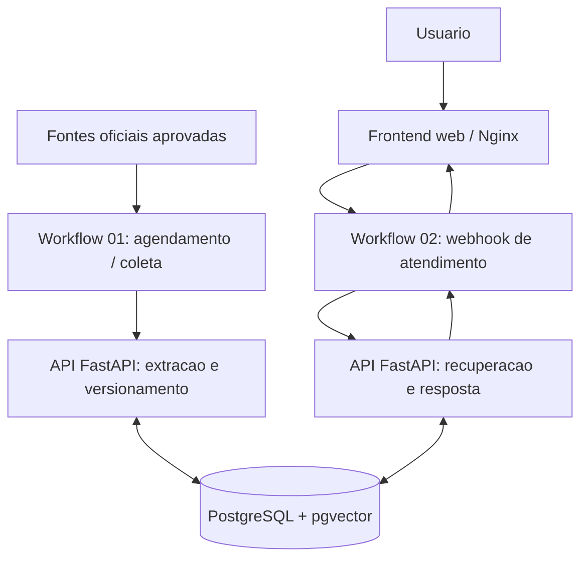

# Assistente de Atendimento — UBS e USF de Marília/SP


Plataforma experimental de consulta a **informações administrativas** sobre Unidades Básicas de Saúde (UBS) e Unidades de Saúde da Família (USF) de Marília, SP. Automatiza a coleta programada de páginas oficiais, registra revisões e oferece consultas com referências verificáveis.

> **Status: fase de testes — sem integração a API externa paga.** Atualmente o sistema opera no **modo extrativo com busca lexical**: localiza trechos provenientes das fontes oficiais cadastradas e os exibe sem sintetizá-los com um modelo de linguagem. A API interna em Python permanece ativa; “sem API” aqui significa **sem chave de serviço de IA generativa**, não ausência do backend. O suporte opcional a embeddings e geração de respostas está implementado, mas não é requisito para executar o ambiente.

> **Aviso institucional:** projeto independente, não vinculado à Prefeitura Municipal de Marília nem à Secretaria Municipal da Saúde. Não oferece diagnóstico, triagem, agendamento, disponibilidade de vacinas em tempo real ou aconselhamento médico. Confirme horários, documentos e campanhas diretamente com a unidade quando a informação for crítica.

## Funcionalidades

- Coleta automática de URLs **explicitamente aprovadas** em `sources.json`, agendada no n8n a cada seis horas (intervalo configurável).
- Download de HTML oficial, limpeza do texto, segmentação em trechos e detecção de alterações por hash SHA-256.
- Histórico de versões no PostgreSQL: revisões antigas permanecem registradas, enquanto somente a versão ativa é pesquisável.
- Consulta por texto completo em português, similaridade lexical e correspondência mais restritiva quando a pergunta identifica uma UBS/USF.
- Exibição do **trecho original**, link de origem e data da última coleta bem-sucedida, sem inventar respostas no modo de testes.
- Modo RAG opcional, mediante configuração consciente da chave de um provedor externo.
- Interface responsiva, proxy reverso e limitação de requisições; n8n disponível apenas em `localhost`.
- Testes automatizados e validação contínua no GitHub Actions.

## Stack técnica

| Camada | Tecnologia | Responsabilidade |
| --- | --- | --- |
| Orquestração | **n8n 2.x** | Schedule Trigger, Webhook, chamadas HTTP e publicação de workflows |
| Backend | **Python 3, FastAPI, Pydantic** | API interna, regras de aplicação e validação |
| Coleta | **Requests + Beautiful Soup** | Recuperação e extração de documentos HTML |
| Persistência | **PostgreSQL 16** | Fontes, trechos, metadados, histórico e busca textual |
| Busca vetorial opcional | **pgvector** | Armazenamento e busca de embeddings quando habilitados |
| Frontend | **HTML, CSS e JavaScript** | Interface acessível por navegador |
| Servidor web | **Nginx** | Arquivos estáticos, proxy, cabeçalhos de segurança e rate limiting |
| Infraestrutura | **Docker Compose** | Inicialização e integração entre serviços |
| Qualidade | **pytest + GitHub Actions** | Testes, sintaxe e validação dos workflows |

## Arquitetura



**Dois processos independentes:** o primeiro verifica e atualiza a base; o segundo recebe perguntas e recupera trechos já indexados. A conversa não acessa páginas arbitrárias da internet. Nenhuma URL enviada pelo usuário é consultada durante o atendimento.

Veja [Arquitetura e decisões técnicas](docs/ARQUITETURA.md), [Operação](docs/OPERACAO.md) e [Migração do n8n verificada](docs/MIGRACAO_N8N.md).

## Instalação e operação (Windows 11) — arquitetura migrada

**Requisitos:** Docker Desktop com WSL 2 e Python 3.11+. A instalação do n8n é separada do Compose principal para manter uma nova chave sem reativar a instância antiga.

**Instalação local validada em 09/11/2026:** a nova instância do n8n usa SQLite em `ubs_n8n_nova_data`, sua própria chave privada e a porta 5679. O Compose principal contém PostgreSQL, FastAPI e Nginx (porta 8080). O n8n antigo foi parado e **não faz mais parte dos serviços de inicialização do Compose principal**. Nunca use `docker compose down -v`.

1. Abra o PowerShell na pasta do projeto. Preserve o `.env` do PostgreSQL e a chave nova em `$HOME\Documents\UBS-Backup\migracao-n8n\.env`, **ambos privados e distintos**.
2. Copie o template `deploy/n8n-migrado.compose.yaml` para `$HOME\Documents\UBS-Backup\migracao-n8n\compose.yaml` (preserve cópia do Compose privado anterior). Não substitua o `.env` novo.
3. Inicie **na ordem**:
   ```powershell
   $pasta = "$HOME\Documents\UBS-Backup\migracao-n8n"
   docker compose up -d --build db api
   docker compose -f "$pasta\compose.yaml" up -d
   docker compose up -d web
   docker compose ps
   python scripts/validar_execucao.py
   ```
   Alternativa segura para a instalação existente: `powershell -ExecutionPolicy Bypass -File .\scripts\iniciar_windows.ps1`.
4. Abra o editor do [n8n migrado](http://localhost:5679). Verifique que os **dois** workflows estejam separados e publicados; mantenha o fluxo de coleta antigo despublicado.
5. Abra o [chat local](http://localhost:8080). O modo padrão continua **extrativo/lexical, sem API paga de IA**.

Para uma **instalação nova do zero**, com o `.env` do banco gerado com `python scripts/gerar_env.py` (somente se ainda não houver volumes persistentes), execute `powershell -ExecutionPolicy Bypass -File .\scripts\preparar_n8n_migrado.ps1` para criar **sem sobrescrever** o arquivo privado e o volume novo; em seguida, inicie na ordem indicada e importe os dois workflows via interface. Consulte o [guia de migração](docs/MIGRACAO_N8N.md). Não reaproveite a chave antiga exposta. Este guia preserva dados de instalações já migradas e não gera uma chave sobre SQLite existente.

> **Importante:** o projeto contém somente o **template sem segredos** do n8n migrado. A instância depende do arquivo `.env` privado, do volume `ubs_n8n_nova_data` e da rede `assistente-ubs-marilia_private`. Não é seguro publicar esses dados para tornar o tutorial "plug-and-play".

## Execução sem serviço pago de IA

O modo atual não chama nenhuma API paga de LLM ou embeddings. A busca utiliza PostgreSQL Full Text Search e similaridade de palavras. Os trechos recuperados são apresentados **sem interpretação clínica ou reescrita gerativa**.

Limitações explícitas:
- um resultado lexicalmente parecido **não comprova** que o documento está atualizado;
- conteúdo extraído pode conter campos adjacentes e exigir leitura do contexto;
- fontes oficiais podem divergir (por exemplo, notícia recente versus cadastro geral);
- ausência de resultado não significa ausência do serviço no município;
- o horário de coleta é diferente da data de publicação e da data de vigência.

O suporte a LLM é opcional e deve ser habilitado somente com aprovação do projeto, previsão de custos e revisão de privacidade. Não envie dados pessoais ou clínicos a serviços externos.

## Endereços locais

| Serviço | Endereço |
| --- | --- |
| Interface de consultas | http://localhost:8080 |
| Editor n8n migrado | http://localhost:5679 |
| Banco e API | Acessíveis somente na rede interna do Docker |

A documentação automática do FastAPI não é exposta publicamente. O backend oferece `GET /health`, `GET /internal/status`, `POST /internal/reindex` e `POST /internal/answer` **na rede privada**. A interface utiliza o webhook do n8n e o proxy do Nginx.

## Estrutura de pastas

```text
.
├── .github/workflows/ci.yml       # Testes automáticos\n├── deploy/n8n-migrado.compose.yaml # Template sem chaves para n8n novo
├── api/
│   ├── app/                       # API, coletor, busca e integrações opcionais
│   ├── Dockerfile
│   └── requirements*.txt
├── db/init.sql                     # Esquema, índices e extensões
├── docs/                           # Arquitetura e operação
├── nginx/default.conf              # Proxy e limitações HTTP
├── scripts/                        # Inicialização e importação
├── tests/                          # Testes automatizados
├── web/                            # Interface web
├── workflows/                      # Arquivos JSON importáveis pelo n8n
├── sources.json                    # Fontes autorizadas
├── .env.example                    # Exemplo SEM credenciais
└── docker-compose.yml
```

## Qualidade e testes

```powershell
python -m pip install -r api/requirements-dev.txt
python -m pytest -q tests/
python -m compileall -q api/app scripts
docker compose config
```

O GitHub Actions executa testes e valida JSONs em novas alterações. A integração completa (coleta real, execução no n8n e consulta de banco em contêineres) deve ser validada no ambiente de execução; testes unitários não substituem esse procedimento.

## Execução real auditada (08/11/2026)

Recebemos os dois arquivos produzidos pelo teste local e auditamos respostas, referências, tempos e metadados. O sistema estava em `extractive_lexical`, com **6 fontes disponíveis, 92 trechos ativos e nenhuma falha de fonte**. O workflow de coleta foi comprovado em execução separada no n8n (1 fonte atualizada, 5 inalteradas e nenhuma falha).

O script anterior marcou **4/4 consultas como PASSOU tecnicamente**, mas uma revisão da relevância revelou **1 falha semântica**: a pergunta sobre o endereço da UBS Castelo Branco recebeu apenas informações sobre seu horário. Os outros três cenários apresentaram o comportamento esperado (documentos de vacinação, abstenção e segurança).

**Correção aplicada:** perguntas de endereço agora exigem indício de logradouro próximo ao nome da unidade; caso contrário, o backend retorna ausência de evidência suficiente. A avaliação automática também verifica relevância mínima dos trechos. A correção exige uma nova execução local antes de alegar que está validada ponta a ponta.

- [Auditoria de perguntas, respostas resumidas, links oficiais e falha identificada](docs/AUDITORIA_RESPOSTAS_REAIS_2026-11-08.md)
- [Resultados da coleta e demonstração](docs/EVIDENCIAS_EXECUCAO_2026-11-08.md)
- [Como repetir os testes](docs/DEMONSTRACAO.md)

Os relatórios integrais não são publicados automaticamente; a documentação contém apenas resumo revisado e URLs públicas. **Sem LLM ativa e sem API paga de IA.**

## Demonstração auditável e testes de integração

**Modo atual: extrativo/lexical; nenhuma LLM ativa e nenhuma chamada a API paga de IA.**

O repositório inclui um roteiro de [demonstração reproduzível](docs/DEMONSTRACAO.md) que distingue testes unitários, contratos estáticos, integração com banco real e execução ponta a ponta. Os testes automatizados não devem ser descritos como confirmação de que o n8n foi executado com as fontes oficiais.

O CI agora possui dois jobs: **unit-and-contract** e **fastapi-postgres-integration** (PostgreSQL/pgvector real e respostas HTTP FastAPI em processo). Ambos produzem relatórios JUnit XML anexados aos workflows; isso ainda não valida os serviços externos, o Nginx ou a execução do n8n.

Para registrar **perguntas reais, respostas recebidas, fontes, horários de coleta, falhas controladas e resultado por caso** em sua instalação local, publique os workflows, realize a primeira coleta e execute:

    python scripts/validar_execucao.py

Opcionalmente, para coletar via backend antes de testar:

    python scripts/validar_execucao.py --coletar

O comando gera relatórios JSON e Markdown em **artifacts/**, ignorados pelo Git. Um cenário sem evidência ou um endpoint indisponível ficará marcado **FALHOU**; o programa não fabrica respostas nem transforma falhas em sucesso. A coleta opcional usa diretamente o backend Docker e **não** comprova a execução do workflow 01 do n8n.

Se uma fonte falhar ao atualizar, a API passa a expor seu estado e a interface avisa que um trecho anteriormente indexado pode estar desatualizado. A resposta continua exigindo conferência na página oficial.

## Fontes, atualização e governança

As URLs iniciais estão em [`sources.json`](sources.json) e abrangem páginas da Prefeitura de Marília, Secretaria Municipal da Saúde e Ministério da Saúde. Adicionar uma fonte exige revisar sua legitimidade, escopo, disponibilidade e políticas de acesso. Os domínios permitidos são validados no backend; redirecionamentos para outros domínios são rejeitados.

O sistema evita descartar o conteúdo previamente indexado quando uma coleta falha, porém **não garante a atualidade do dado**: consulte os registros de coleta e valide informações conflitantes antes de divulgação institucional.

## Auditoria de credenciais (somente leitura)

Para a instalação local, execute:

```powershell
python scripts/auditar_segredos.py
```

O auditor verifica configurações de segurança sem imprimir senhas ou chaves e **não altera credenciais**. A chave principal do n8n apareceu em um diagnóstico anterior e deve ser tratada como potencialmente exposta. **Não mude `N8N_ENCRYPTION_KEY` diretamente:** isso pode impedir o acesso às credenciais armazenadas. Consulte o [procedimento de segurança e migração controlada](docs/SEGURANCA_CREDENCIAIS.md).

A rotação opcional de chaves de dados no n8n 2.46.5 **não substitui** a chave mestra exposta. **A migração local foi executada e testada em 09/11/2026**: a nova instância usa chave inédita, SQLite independente e dois workflows; o n8n antigo foi desligado, preservando os backups. Consulte [evidências e procedimentos de recuperação](docs/MIGRACAO_N8N.md).

## Segurança, privacidade e escopo

- Dados de saúde e informações de identificação de pacientes **não devem ser enviados** ao chat.
- O sistema não autentica cidadãos nem está preparado para exposição pública na internet.
- O n8n e o chat escutam apenas `127.0.0.1` no ambiente Docker Compose fornecido.
- Nunca versionar `.env`, tokens, credenciais, bancos exportados, dumps ou dados reais de pacientes.
- Para produção: HTTPS, controle de acesso, monitoramento, política de retenção e auditoria, revisão institucional e avaliação de LGPD e acessibilidade.

## Migração operacional comprovada (09/11/2026)

Em execução local, após corrigir uma montagem antiga de `sources.json` na FastAPI, o workflow 01 do **n8n novo** processou **6 fontes (6 inalteradas, 0 falhas)**. O workflow 02 do n8n novo continuou aprovando **4/4 cenários** pelo Nginx, inclusive **após parar o n8n legado**. A configuração versionada agora registra o novo proxy e impede que o Compose principal inicialize o n8n antigo.

Essa evidência não comprova ausência de outras vulnerabilidades nem vigência clínica ou administrativa das fontes. Os backups e a antiga chave ainda existem somente nos arquivos/volumes privados do operador.

## Evolução planejada

- Validadores de atualidade por categoria e reconciliação estruturada de horários.
- Painel de qualidade de fontes e alertas por coleta malsucedida.
- Avaliação de recuperação com conjunto de perguntas rotuladas e métricas de precisão/abstenção.
- Integração opcional de LLM, após aprovação de custos e privacidade.

---

**Natureza do projeto:** protótipo técnico em fase de testes. Nenhum conteúdo deve ser interpretado como orientação médica ou comunicação oficial do município.


### Guia para manutenção e integrações

Para localizar responsabilidades, estender a coleta, a busca ou os endpoints sem
quebrar contratos existentes, consulte [docs/GUIA_MANUTENCAO.md](docs/GUIA_MANUTENCAO.md).
As regras de intenção/evidência ficam em `api/app/query_policy.py`; a extração
HTML e o particionamento ficam em `api/app/text_processing.py`.
